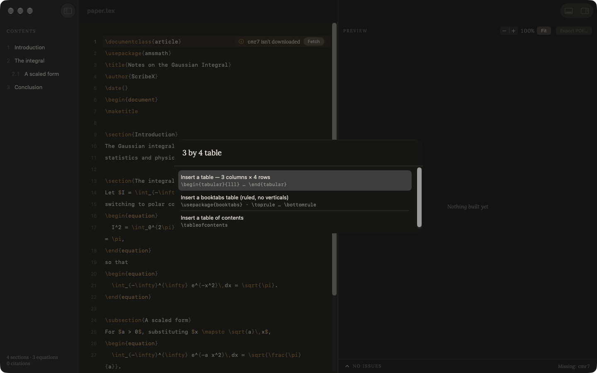
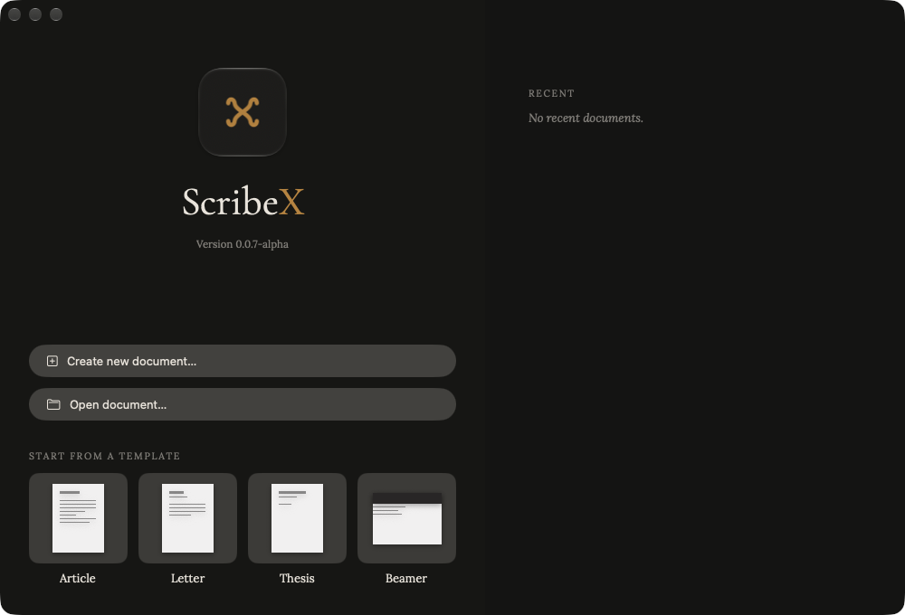

# ScribeX

**Overview** · [Development](docs/DEVELOPMENT.md) · [Offline behaviour](docs/OFFLINE.md)

An offline LaTeX editor for macOS. Write on the left and the PDF updates on the
right as you type. You don't need a TeX Live install, a server or an account.

## Features

- **Live preview.** The PDF rebuilds a moment after you stop typing, usually in
  under a second.
- **Readable errors.** TeX's complaints come back in plain English and jump to
  the line at fault. Some come with a one-click fix.
- **⌘K palette.** Describe what you want ("3 by 4 table", "figure") and get the
  LaTeX, or run any command by name.
- **A real Mac app.** One window per `.tex` file, with Auto Save, Versions,
  Open Recent and export to PDF (⌘E).
- **Starter templates** for an article, letter, thesis or Beamer slides.
- **Works offline.** Typesetting runs on your Mac. The network is only used
  when you ask it to fetch a package or font.

  

## Install

Download the latest `ScribeX-<version>.dmg` from
[Releases](https://github.com/velociraptor98/scribex/releases) and drag
ScribeX to Applications. It needs macOS 26 on Apple Silicon.

The app isn't notarized yet, so macOS blocks it the first time. Allow it once
under **System Settings → Privacy & Security → Open Anyway**.

On first launch, click **Download now** to fetch the LaTeX packages and fonts
(about 40 MB, once). After that ScribeX works fully offline.

## Development

Build instructions, the architecture, and where to make changes are in
[docs/DEVELOPMENT.md](docs/DEVELOPMENT.md).

## Licence

ScribeX's editor component, STTextView, is GPL v3 (or commercial).
Third-party notices are in
[THIRD-PARTY-NOTICES.md](macos/licenses/THIRD-PARTY-NOTICES.md).
